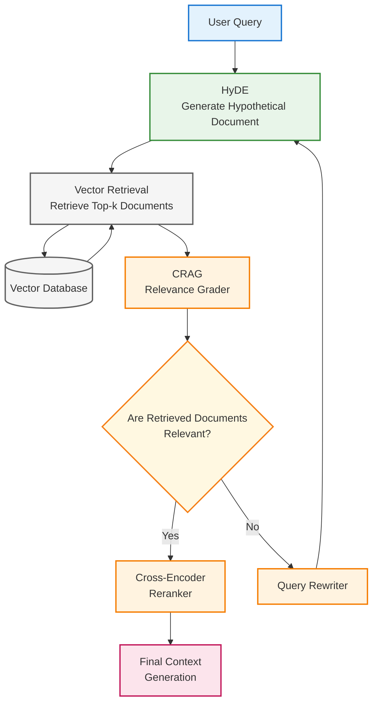
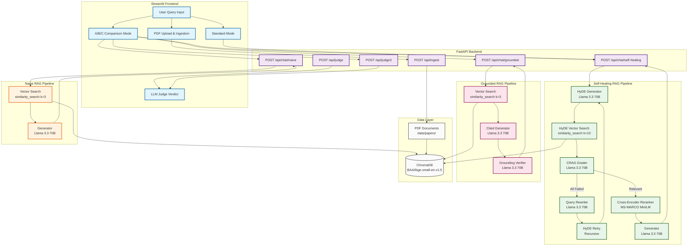

# Self-Healing RAG Chatbot

A Retrieval-Augmented Generation (RAG) system with a closed-loop "self-healing" pipeline. Built with LangChain, Groq, ChromaDB, and a Streamlit frontend.

---

## Architecture Overview



### Full System Diagram



---

## Pipeline Architecture Details

### 1. Naive RAG (Baseline)
**Purpose:** Direct vector similarity search without quality control.

```
Query → Vector Search (k=3) → Generator → Answer
```

- **Vector Search:** ChromaDB similarity search using BAAI/bge-small-en-v1.5 embeddings
- **Generator:** Llama 3.3 70B (via Groq) with temperature 0.2
- **Use Case:** Simple factual lookups where speed matters more than precision

---

### 2. Self-Healing RAG (Primary Pipeline)
**Purpose:** Closed-loop retrieval with iterative quality control.

```
Query
  │
  ▼
┌─────────────────────────────────────┐
│  HyDE: Hypothetical Document Gen    │  ← Llama 3.3 70B generates academic-style
│  (Expands short query to full doc)  │     hypothetical paper excerpt
└─────────────────────────────────────┘
  │
  ▼
┌─────────────────────────────────────┐
│  HyDE Vector Search (k=10)          │  ← Search with dense hypothetical doc
└─────────────────────────────────────┘
  │
  ▼
┌─────────────────────────────────────┐
│  CRAG: Corrective RAG Grader        │  ← Binary relevance grading (yes/no)
│  • Grades each retrieved doc        │     Strict: only 'yes' or 'no' output
│  • Filters irrelevant docs          │
└─────────────────────────────────────┘
  │
  ├─► If ANY relevant → Cross-Encoder Rerank
  │
  └─► If ALL failed → Query Rewriter (max 2 retries)
        │
        ▼
    Rewrite Query → HyDE Retry (recursive)
```

**CRAG Logic:**
- Grades each document independently
- If ≥1 document passes → proceed with filtered set
- If 0 documents pass → rewrite query semantically for academic search → retry (max 2 attempts)

**Cross-Encoder Reranking:**
- Model: `cross-encoder/ms-marco-MiniLM-L-6-v2`
- Scores query-document pairs directly (not independent embeddings)
- Returns top-k (default 3) highest-precision matches

**Final Generation:**
- Llama 3.3 70B with strict grounding instructions
- Temperature 0.2 to minimize hallucination
- References specific documents by number

---

### 3. Grounded RAG (Citation + Verification)
**Purpose:** Generate answers with inline citations and verify each claim.

```
Query → Vector Search (k=3) → Cited Generator → Grounding Verifier → Answer + Score
```

**Cited Generator:** Produces answer with `[Doc N]` citations for each claim
**Grounding Verifier:** Checks each cited claim against source documents
- Returns `grounding_score` (0-1), `verified_claims`, `total_claims`

---

### 4. LLM Judge (Evaluation)
**Purpose:** Impartial comparison of pipeline outputs.

**2-Way Judge (Naive vs Self-Healing):**
- Favors Self-Healing for complex/academic queries
- Favors Naive for simple factual lookups (speed)

**3-Way Judge (Naive vs Grounded vs Self-Healing):**
- Evaluates: Accuracy, Grounding, Retrieval Quality, Speed/Quality Tradeoff
- Uses CRAG/rerank diagnostics and grounding score as signals
- No systematic bias toward any pipeline

---

## Component Specifications

| Component | Technology | Model | Key Parameters |
|-----------|------------|-------|----------------|
| Embeddings | HuggingFace / LangChain | BAAI/bge-small-en-v1.5 | normalize_embeddings=True, device=cpu |
| Vector DB | ChromaDB | Persistent local | cosine similarity |
| LLM (All) | Groq API | llama-3.3-70b-versatile | varies by component |
| HyDE Generator | LangChain + Groq | llama-3.3-70b-versatile | temperature=0.3 |
| CRAG Grader | LangChain + Groq | llama-3.3-70b-versatile | temperature=0, structured yes/no |
| Query Rewriter | LangChain + Groq | llama-3.3-70b-versatile | temperature=0.1 |
| Reranker | sentence-transformers | cross-encoder/ms-marco-MiniLM-L-6-v2 | max_length=512 |
| Final Generator | LangChain + Groq | llama-3.3-70b-versatile | temperature=0.2 |
| Judge | LangChain + Groq | llama-3.3-70b-versatile | temperature=0.1 |
| Frontend | Streamlit | - | async aiohttp streaming |

---

## API Endpoints

| Endpoint | Method | Description |
|----------|--------|-------------|
| `/api/chat/naive` | POST | Naive RAG streaming (NDJSON) |
| `/api/chat/self-healing` | POST | Self-Healing RAG streaming (NDJSON) |
| `/api/chat/grounded` | POST | Grounded RAG streaming (NDJSON) |
| `/api/judge` | POST | 2-way pipeline comparison |
| `/api/judge3` | POST | 3-way pipeline comparison |
| `/api/ingest` | POST | Upload & ingest PDF into ChromaDB |

### Request/Response Formats

**Chat Request:**
```json
{"query": "What is the difference between FedAvg and FedProx?"}
```

**Streaming Response (NDJSON - one JSON per line):**
```json
{"step": "Generating HyDE hypothetical document..."}
{"step": "Running CRAG relevance grading on 10 docs..."}
{"step": "Cross-Encoder reranking 7 docs..."}
{"step": "Synthesizing final answer with verified context..."}
{"answer": "FedAvg...", "diagnostics": {"hyde_retrieved": 10, "crag_passed": 7, "reranked_final": 3}, "latency": 4.2}
```

---

## Data Flow

```
┌─────────────┐     ┌──────────────┐     ┌─────────────┐     ┌──────────────┐
│  PDF Files  │────▶│  Ingestion   │────▶│  ChromaDB   │◀───▶│  All Pipelines│
│  (data/     │     │  • PyPDF     │     │  • Embed:   │     │  • Query      │
│   papers/)  │     │  • Chunk     │     │    bge-small│     │  • Retrieve   │
└─────────────┘     │  • Embed     │     │  • Persist  │     └──────────────┘
                    └──────────────┘     └─────────────┘
                           │
                    Chunk: 1000 chars
                    Overlap: 200 chars
                    Separators: \n\n, \n, ., " ", ""
```

---

## Project Structure

```
Self-Healing RAG chatbot/
├── backend/
│   ├── requirements.txt
│   └── app/
│       ├── __init__.py
│       ├── config.py           # Environment config (API keys, paths, model names)
│       ├── embeddings.py       # BAAI/bge-small-en-v1.5 embedding function
│       ├── ingestion.py        # PDF loading, chunking, ChromaDB persistence
│       ├── hyde.py             # HyDE hypothetical document generation + retrieval
│       ├── crag.py             # CRAG grading, query rewriting, recursive retry
│       ├── reranker.py         # Cross-Encoder MS-MARCO reranking
│       ├── generator.py        # Final answer synthesis with citations
│       ├── grounded_rag.py     # Cited generation + grounding verification
│       ├── judge.py            # LLM-as-judge evaluation (2-way & 3-way)
│       └── main.py             # FastAPI endpoints, streaming orchestration
├── frontend/
│   ├── requirements.txt
│   └── app.py                  # Streamlit UI with A/B/C comparison tabs
├── data/
│   └── papers/                 # Source PDFs for ingestion
├── chroma_db/                  # Persistent vector database
├── .env                        # GROQ_API_KEY, VECTOR_DB_DIR
├── .env.example
├── render.yaml                 # Render.com deployment config
└── README.md
```

---

## Setup & Installation

### Prerequisites
- Python 3.10+
- Groq API Key (free at https://console.groq.com)

### Backend

```bash
cd backend
python -m venv .venv
source .venv/bin/activate  # Windows: .venv\Scripts\activate
pip install -r requirements.txt

# Configure environment
cp ../.env.example ../.env
# Edit .env and add your GROQ_API_KEY

# Ingest documents (run once)
python -m backend.app.ingestion

# Start API server
uvicorn backend.app.main:app --reload --port 8000
```

### Frontend (separate terminal)

```bash
cd frontend
pip install -r requirements.txt
streamlit run app.py
```

### Access
- Frontend: http://localhost:8501
- API Docs: http://localhost:8000/docs

---

## Key Features

| Feature | Description |
|---------|-------------|
| **HyDE** | Expands short queries into hypothetical academic documents for better semantic matching |
| **CRAG** | Binary relevance grading with automatic query rewriting on total failure (max 2 retries) |
| **Cross-Encoder Reranking** | Precision scoring of query-doc pairs using MS-MARCO MiniLM |
| **Grounded RAG** | Inline citations + claim-level grounding verification |
| **LLM Judge** | Impartial multi-pipeline evaluation with structured rationale |
| **Streaming UI** | Live step-by-step telemetry for all pipelines simultaneously |
| **PDF Upload** | Dynamic ingestion of custom documents at runtime |
| **Deployment Ready** | Render.com config included |

---

## Environment Variables

| Variable | Required | Default | Description |
|----------|----------|---------|-------------|
| `GROQ_API_KEY` | Yes | - | Groq API key for Llama 3.3 70B |
| `VECTOR_DB_DIR` | No | `./chroma_db` | ChromaDB persistence directory |
| `EMBEDDING_MODEL_NAME` | No | `BAAI/bge-small-en-v1.5` | HuggingFace embedding model |

---

## Test Queries

| Category | Query | Tests |
|----------|-------|-------|
| **Vocabulary Mismatch** | "Why is it better to aggregate weights on a central server rather than just uploading all the user's mobile data?" | HyDE expansion |
| **Deep Comparison** | "What is the core mathematical difference between Federated SGD and Federated Averaging?" | Cross-Encoder precision |
| **Out-of-Scope** | "What is my current GPA?" | CRAG filtering (should find nothing) |
| **Multi-hop** | "How does FedProx's proximal term address the heterogeneity problem in FedAvg?" | Full pipeline reasoning |

---

## Deployment (Render.com)

1. Push to GitHub
2. Connect repository to Render
3. Use `render.yaml` for Blueprint deploy
4. Add `GROQ_API_KEY` as secret in Render dashboard
5. Services deployed:
   - **Web Service:** FastAPI backend (port 8000)
   - **Static Site:** Streamlit frontend (port 8501)

---

## License

MIT License - Feel free to use and modify for research or production.
